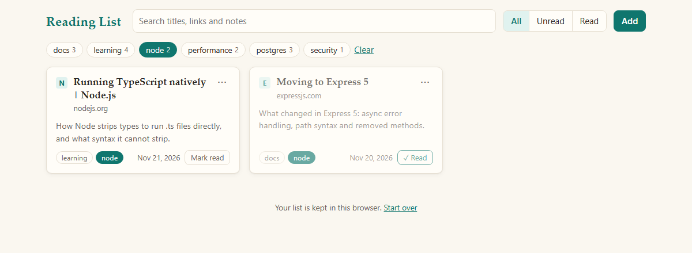
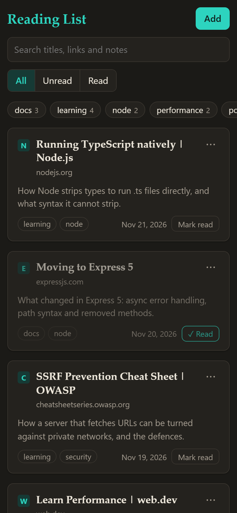

# Bookmark & Reading List Manager

Save links, tag them, and keep a reading list. Paste a link and the server fills in the page's title, description and icon; filter by tags, by read state and by text.

**Live:** https://bookmark-manager-df51.onrender.com/

> This is a demo on free tiers. After about 15 minutes without visitors the server goes to sleep, so the first visit can take up to a minute. Each browser gets its own private list, started with eight sample bookmarks; a list nobody opens for 30 days is removed.

<p>
  
  
</p>

Project 4 of a full-stack practice series. The new skill here is PostgreSQL with Prisma.

## Features

- Save a link with its title, description and icon filled in from the page (on paste, or when you leave the field); every field stays editable, and if the page cannot be read the title falls back to the site's name.
- Tags as chips, with suggestions from the tags you already use; at most 10 per bookmark, each 1 to 30 lower-case letters, digits or dashes.
- Filter by one or more tags (a bookmark must have all of them), by All, Unread or Read, and by text in the title or link. The filters live in the address bar, so a filtered view can be bookmarked, reloaded, and stepped through with Back.
- Mark read or unread, edit, and delete with a confirm; the change shows at once and rolls back if the server refuses it.
- Saving a link you already have offers to open the existing one instead.
- Tag counts in the filter row, and "Load more" paging, 24 at a time, newest first.
- One private list per browser, with no accounts. "Start over" in the footer makes a fresh list with the samples.
- Light and dark themes follow the system setting, and the layout works on a phone.

## Stack

| Part | Tools |
| ---- | ----- |
| Language | TypeScript on both sides |
| Client | React 19, Vite, oxlint |
| Server | Node, Express 5, Zod 4, `cheerio`, `undici`, `helmet`, `express-rate-limit`; Node runs the `.ts` files directly, and `tsc --noEmit` checks them |
| Database | PostgreSQL 18 through Prisma 7 and its `pg` driver adapter; Neon in production |
| Tests | Vitest and Supertest against a real PostgreSQL, run in GitHub Actions on every push |
| Hosting | Render free web service, described in `render.yaml`; Express serves the built client |

## Data model

```
Owner 1──* Bookmark *──* Tag
             (through BookmarkTag)
```

- **Owner:** one per browser, found by a random key the browser keeps in `localStorage` and sends in the `X-Owner-Key` header. `lastSeenAt` drives the 30-day clean-up.
- **Bookmark:** `url`, `title`, `description`, `iconUrl`, and `readAt` (empty means unread, so one column says whether and when). A link is unique per owner.
- **Tag:** a lower-case name, unique per owner. A tag no bookmark uses any more is deleted.
- **BookmarkTag:** the join table, written out rather than left to Prisma, to show what a many-to-many relation is in SQL.

Deleting an owner removes their bookmarks and tags through `ON DELETE CASCADE`. The schema is in `server/prisma/schema.prisma`, and every change to it is a committed migration in `server/prisma/migrations`.

Paging is keyset paging on `(createdAt, id)`, with an index in that order: the cursor says "after this bookmark", so adding or deleting one between pages never skips or repeats a card.

## API

Every route except `POST /api/owners` and `GET /api/health` needs the `X-Owner-Key` header; a missing or unknown key gets `401`.

| Method | Route | Does |
| ------ | ----- | ---- |
| `POST` | `/api/owners` | Make an owner with the sample bookmarks; returns `201` with `{ key }` |
| `GET` | `/api/bookmarks?tag=&tag=&status=&q=&cursor=` | One page of bookmarks, filtered; returns `{ items, nextCursor }` |
| `POST` | `/api/bookmarks` | Create from `{ url, title, description?, iconUrl?, tags? }`; `201`, or `409` with the existing bookmark |
| `PATCH` | `/api/bookmarks/:id` | Change any of `title`, `description`, `tags`, `read` |
| `DELETE` | `/api/bookmarks/:id` | Delete one; `204` |
| `GET` | `/api/tags` | Tags with how many bookmarks carry each |
| `POST` | `/api/preview` | Read a page's title, description and icon from `{ url }` |
| `GET` | `/api/health` | `200` when the database answers, `503` when it does not |

Errors are JSON:

| Status | When |
| ------ | ---- |
| `400` | Bad input, or a preview address that is not allowed, with `{ error, issues: [{ field, message }] }` |
| `401` | No owner key, or an unknown one |
| `404` | No such bookmark for this owner; another owner's bookmark answers `404` too, so ids reveal nothing |
| `409` | The link is already saved |
| `422` | The page could not be read for a preview |
| `429` | Over 10 new owners per hour from one address, or 30 previews per minute |

### The preview and SSRF

A server that fetches any address a visitor types can be pointed at places only the server can reach: `localhost`, the cloud's metadata service at `169.254.169.254`, or a private network. That is SSRF (server-side request forgery). The guard in `server/src/safeFetch.ts`:

- allows only `http` and `https` on ports 80 and 443;
- checks the address **when connecting**, through a custom DNS lookup, and refuses loopback, private, link-local, carrier-grade NAT, multicast and unspecified addresses, IPv4 and IPv6 alike, so a name that resolves to a safe address first and a private one later (DNS rebinding) is still caught;
- follows at most 3 redirects by hand, each checked the same way;
- stops after 5 seconds or 512 KB, and parses only `text/html`.

The icon address is only stored, never fetched by the server; the browser loads it.

## Run it locally

Needs Node 26 (pinned in `.node-version`; it runs TypeScript files directly) and PostgreSQL 18.

1. Create a database role, and two databases owned by it: `bookmarks_dev` and `bookmarks_test`. The role needs `CREATEDB`, because `prisma migrate dev` makes a temporary shadow database.

   ```sql
   CREATE ROLE bookmarks LOGIN CREATEDB PASSWORD 'choose-one';
   CREATE DATABASE bookmarks_dev OWNER bookmarks;
   CREATE DATABASE bookmarks_test OWNER bookmarks;
   ```

2. Install, and set up the database addresses:

   ```bash
   git clone https://github.com/Sanbogukai/bookmark-manager.git
   cd bookmark-manager
   cd server && npm install
   cp .env.example .env         # then put your password in DATABASE_URL
   cp .env.example .env.test    # same, with bookmarks_test as the database
   npx prisma migrate dev
   cd ../client && npm install && cd ..
   ```

3. Then in two terminals:

   ```bash
   cd server && npm run dev    # API on http://localhost:3000
   ```

   ```bash
   cd client && npm run dev    # app on http://localhost:5173, with /api sent to the server
   ```

   If port 3000 is taken, start the server with `PORT=3001` and the client with `API_SERVER=http://localhost:3001`.

### Production build

```bash
cd client && npm run build && cd ../server && npm start
```

Express then serves the API and the app from one address: `/api` first, then the hashed files in `/assets` (cached for a year), then `index.html` for every other page (never cached, so a new deploy shows at once).

## Tests

```bash
cd server && npm test
cd client && npm test
```

The server has 82 tests in 8 files, against the real `bookmarks_test` database. Before the run the migrations are applied; a guard refuses any database whose name does not end in `_test`; between tests every table is emptied. They cover:

- owners: the samples, `401` without a key, and that one owner can never read, change or delete another's bookmarks;
- creating, with tags normalised, every refusal naming its field, and the `409` duplicate;
- the list: newest first, one and two tags (AND), status, search, all combined, and paging that returns every bookmark once even when one is added between pages;
- editing read state and tags, unused tags removed, and deleting;
- the preview, with a fake page fetcher so no test reaches the internet, and the SSRF guard on its own: `127.0.0.1`, `10.0.0.5`, `169.254.169.254`, `[::1]`, other schemes and ports, and a redirect to a private address;
- the built client: caching headers, the page fallback, and the security headers.

The client has 19 unit tests for its pure helpers: filters to and from the address bar, the tag input, and the owner key.

Checks: `npm run typecheck` in `server/` and `client/`, and `npm run lint` in `client/`. GitHub Actions runs all of them against a `postgres:18` service container, plus the client build.

## Deploy notes

`render.yaml` is a Render Blueprint: one free web service in Virginia, next to the Neon database in AWS `us-east-1`, so each query stays in one region. It builds with

```
cd client && npm ci && npm run build && cd ../server && npm ci && npx prisma migrate deploy
```

and starts with `cd server && npm start`. Render deploys a push only after GitHub Actions passes, and sends traffic to a new version only once `/api/health` answers.

Two environment variables are entered in Render, never committed:

- `DATABASE_URL`: Neon's pooled connection string, used by the running app.
- `DIRECT_URL`: Neon's direct connection string, used only by `prisma migrate deploy`, since migrations need a direct connection, not a pooled one.

Each must be the bare `postgresql://...` string. The first deploy failed with Prisma's `P1013` ("the scheme is not recognized") because one value had been copied with extra text around it.

Production is changed only by `prisma migrate deploy`, which applies committed migrations and never resets data.
